# SCORING.md — how goals are scored, shown on real goals

**Status (2026-11-11): draft, eleven situations written.** Each situation is one real goal.
Situations 1 to 9 were played by the game itself and recorded: the pictures are frames of
that goal, and every number in the technical part was read from the engine at that moment,
not worked out by hand. Situations 10 and 11 are a person's goals from SWOS 2020 replays:
their positions are measured from the replay. Situation 10's engine numbers come from a
logged CPU goal of the same kind; situation 11's from the shot lab, which plays a person's
shot through the real game from any spot, thousands of times.

Each situation has three parts:

- **The pictures:** the move, frame by frame, with the positions that matter marked.
- **How, what and why:** for players. What to do, what happens, and why it beats the keeper.
- **Under the hood:** for developers. The functions that ran, the values they saw, and the
  tests the ball passed or failed.

## The situations

| # | situation | the goal |
|---|---|---|
| 1 | [Long shot, curled into the far corner](#1-long-shot-curled-into-the-far-corner) | Hughes v Ogrizovic |
| 2 | [Close-range finish](#2-close-range-finish) | Mathie v Nixon |
| 3 | [One-on-one: the point-blank roll](#3-one-on-one-the-point-blank-roll) | Hughes v Bennett |
| 4 | [Header](#4-header) | Vialli v Bennett |
| 5 | [Penalty](#5-penalty) | Bergkamp v Immel |
| 6 | [Direct free kick](#6-direct-free-kick) | Lomas v Watson |
| 7 | [Chip](#7-chip) | Sharpe v Forrest |
| 8 | [Rebound](#8-rebound) | Sturridge v Day |
| 9 | [Own goal](#9-own-goal) | Roberts (Palace) |
| 10 | [Central shot, bent past the keeper](#10-central-shot-bent-past-the-keeper) | a person's goal in SWOS 2020 (Lazio, team training) |
| 11 | [Long shot from the side: where to stand, where to aim](#11-long-shot-from-the-side-where-to-stand-where-to-aim) | a person's goal in SWOS 2020 (Barcelona, team training), and 32,000 lab shots |

**How often each kind went in** over 1,280 CPU v CPU matches (884 goals; each goal sorted
by `tools/classify.py` from its engine log):

| long shot | close-range | rebound | penalty | header | free kick | chip | own goal |
|---|---|---|---|---|---|---|---|
| 494 | 216 | 105 | 32 | 16 | 10 | 8 | 3 |

The one-on-one roll never ran once in those matches: it needs the attacker's fire button
held, which only a human does (situation 3 explains, and how its goal was made). The long
shots include situation 10's kind: 101 of them were kicked from the middle.

## Reading the pictures

Positions are in the game's own units. One unit is one pixel of the original screen. The
game runs at 50 frames a second (the Amiga gameplay, the default; situations 10 and 11's
replays, from SWOS 2020's AMIGA (60FPS) style, at 60). `y` grows down the pitch.

| landmark | value |
|---|---|
| goal lines | `y = 129` (top), `y = 769` (bottom) |
| goal mouth | `x` 302 to 366; crossbar at height 15 |
| penalty area | `x` 193 to 478, 87 units deep |
| **Finishing zone** | `x` 241 to 431, and less than 75 units from the goal line |
| shooting range | within 213 units of the goal line, kicked in one of the three directions towards goal |
| ball speed | `speed / 516` is roughly units per frame (a plain shot, 2208, is about 4.3) |

A shot from inside the Finishing zone gets the shooter's **Finishing** bonus. A shot from
anywhere else in shooting range gets his **Velocity** bonus (`PlayerKickingBall`,
`src/ball_possession.c`). Players' skills run from 0 to 7 in a match, re-rolled each match
from their file ratings by their form.

---

## 1. Long shot, curled into the far corner

*Coventry City 2-1 Chelsea, minute 54. Mark Hughes shoots from the right, 119 units out.
The shot is aimed diagonally across Steve Ogrizovic and bent back inside the far post.
2-2.*

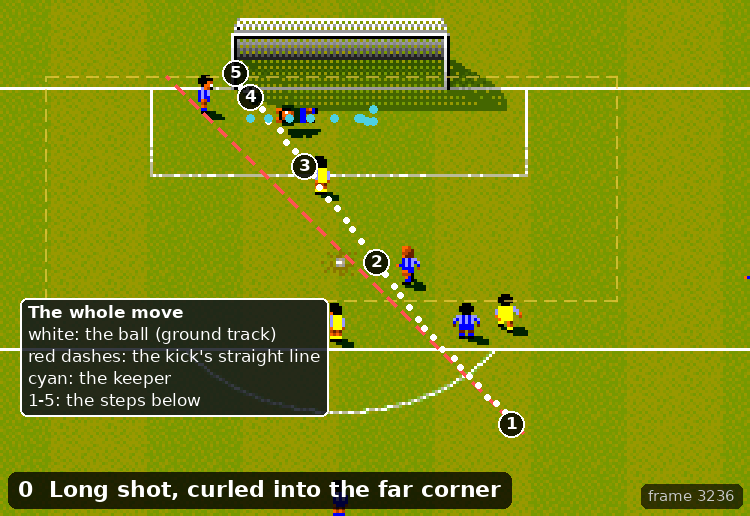

<details>
<summary>The move as the game played it: from the player on the ball to the goal (real speed, then half speed from the shot)</summary>

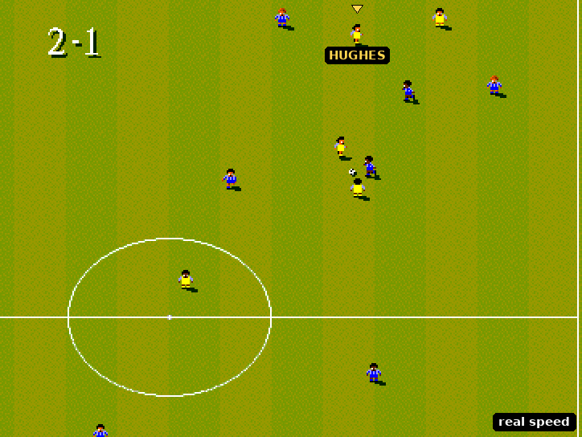

</details>

### How, what and why

**How.** Get the ball to one side of the box, around the edge of the area or a little
further out. Shoot diagonally across the keeper towards the **far** post. Then use
aftertouch (push the stick towards the goal) to bend the ball back inside the post.

**What happens.**

| | |
|---|---|
| 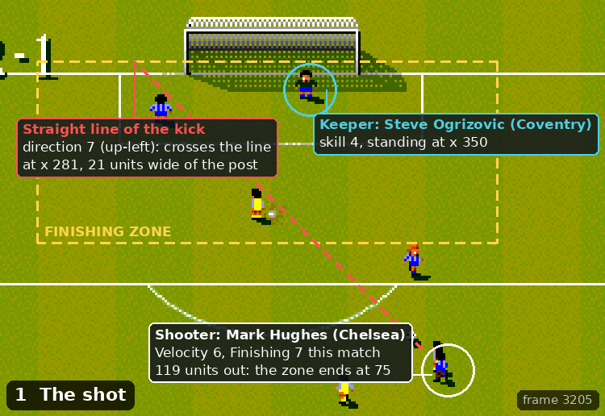 | **1. The shot.** Hughes is 119 units out, 44 too far for the Finishing zone (yellow), so his **Velocity** sets the shot's pace. He kicks up-left. On that straight line (red) the ball would cross the goal line at `x` 281, 21 units wide of the far post. |
| 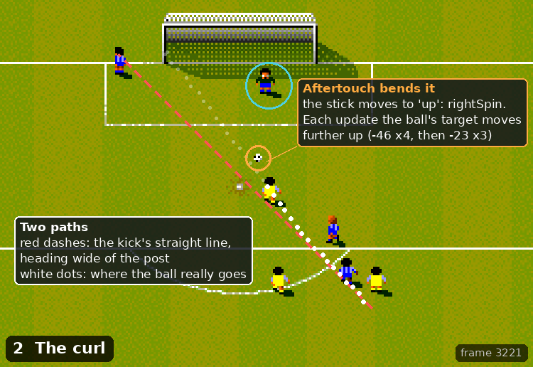 | **2. The curl.** Aftertouch moves the ball's target further "up" over the next updates. The ball leaves the straight line and turns towards the goal (white dots). Its height peaks at 11, under the bar (15). |
| 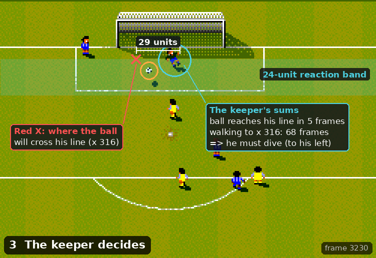 | **3. The keeper decides.** Ogrizovic reacts only once the ball is within 24 units of him, which happens just 5 frames before it reaches his line. By then it will pass 29 units to his left (red X). Walking that far would take 68 frames, so he dives. |
| 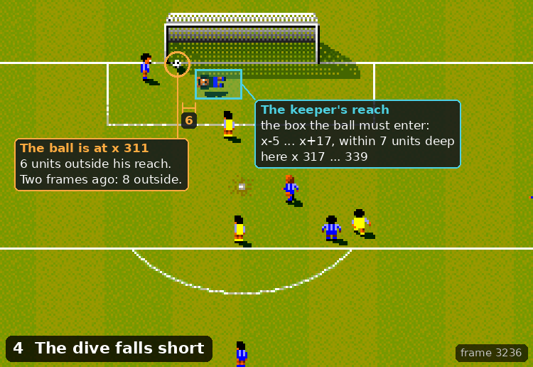 | **4. The dive falls short.** A dive covers about 4 units a frame and slows as it goes. The box he can touch the ball in (cyan) arrives 6 units too late: the ball is already past its leading edge. |
| 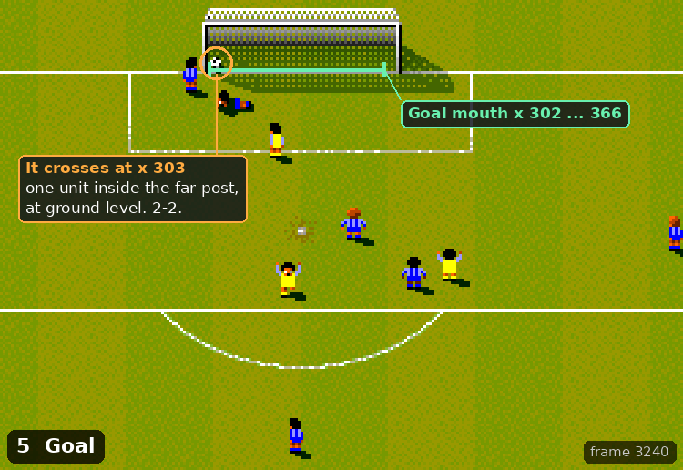 | **5. Goal.** The ball crosses the line at `x` 303, one unit inside the post, at ground level. |

**Why it works.**

1. **The keeper reacts late.** He considers a dive only when the ball is 24 units away. At
   shot speed that leaves him about a tenth of a second.
2. **Every keeper dives at the same speed.** His skill affects *when* he decides to dive
   and whether he catches or parries, but not how fast he flies. The dive starts at about
   4 units a frame and slows down. In the 5 frames he had, it covered about 20 units, and
   he needed 29.
3. **The far corner is the farthest point from the keeper.** While the ball was in the air
   he drifted only 5 units towards it. The far corner leaves him the most ground to cover,
   and he can't make it up.
4. **The curl makes the far corner possible.** From the side, a straight diagonal shot
   misses the far post (here by 21 units). The bend brings it back inside while keeping it
   as far from the keeper as possible.

**Doing it yourself.**

- Push towards the goal **right after** the kick. The bend is strongest in the first
  updates (×5, ×4, ×3, then ×2, ×1). A human who pushes at once bends the ball about twice
  as much as this CPU shot did, because the CPU only started on the fourth update. From
  close in, start a moment later or the ball may curl back towards the near post.
- **Keep the stick pushed for the first fifth of a second.** At aftertouch step 4 (the
  fifth update after the kick) the game checks the stick once. Pulling back turns the shot
  into a chip, and pushing sideways or letting go re-kicks it at a fixed speed with more
  lift. Pushing towards the goal, as here, leaves the shot as it was.
- Inside the Finishing zone the same shot uses Finishing instead of Velocity. For Hughes
  that would have been +608 instead of +270: 14% faster, so even fewer frames for the
  keeper.

### Under the hood

All values are from this goal (recording frames 3205 to 3240), logged in the functions
named below.

**1. The kick: `PlayerKickingBall` (`src/ball_possession.c`).** The ball is at
`(400, 248)`, height 0. Hughes's team attacks the top goal, so the shot test is
`ball.y <= 342` and direction in {7, 0, 1}. It passes: `y` 248, direction 7. The
Finishing-zone test is `x` in [241, 431] **and** `y < 204`. `x` passes and `y` fails
(248), so the bonus comes from Velocity:

```
ball.speed = kBallKickingSpeed + kBallSpeedKicking[velocity 6]
           = 2208 + 270 = 2478              (logged: 2478)     ~4.8 units/frame
ball.dest  = ball + (-1000, -1000)          direction 7: crosses y=129 at x=281
ball.deltaZ = 1.25 units/frame upward       (kBallKickingDeltaZ)
```

With Finishing 7 the bonus would have been `kBallSpeedFinishing[7]` = +608, for a speed of 2816.

**2. In flight.** The ball loses 10 speed per frame in the air (2478 down to 2223 by
frame 3230). Gravity takes about 0.07 a frame off its lift, so its height peaks at 11
around frames 3221 to 3224 and is back to 0 at the goal line.

**3. The curl: `ApplyBallAfterTouch` (`src/ball_physics.c`, docs/GAMEPLAY.md §12.5,
§16.6).** The aftertouch window is `spinTimer` 0 to 9. It advances once per team update,
which is every second frame, so here it ran from frame 3207 to 3225. The CPU's stick
(`currentAllowedDirection`) read 7 (the shot's own direction, no spin) for the first three
updates, then 0 ("up"). That gives `diff = (7 - 0) & 7 = 7`, which sets `rightSpin`. Once
set, the curl runs to the end of the window whatever the stick does:

```
step (spinTimer)    3     4     5     6     7     8     9
multiplier          2     2     2     2     1     1     1     kSpinMultiplierFactor
destY += -23 * m  -46   -46   -46   -46   -23   -23   -23    kKickSpinFactor[dir 7, right] = (0, -23)
destY            -798  -844  -890  -936  -959  -982 -1005    (logged; it starts at -752)
```

Moving the target up turns the ball's heading from 45° towards vertical, so it crosses the
line at `x` 303 instead of 281. At step 4 comes the chip test: stick 0 against direction
7 is `diff` 7, which is neither the NORMAL arm (2 or 6) nor the HIGH arm (3 to 5). The
shot's speed and lift are left alone.

**4. The keeper's dive decision: `ShouldGoalkeeperDive` (`src/goalkeeper.c`).** The skill-4
keeper is at `(350, 140)` when the ball is kicked. He drifts left at 0.44 units a frame,
reaching 345 by frame 3230. The function runs on each of his updates from frame 3218.
Until frame 3228 the ball is more than `kKeeperSaveDistance` = 24 units in front of him
(`dy` 25 at 3228), and it returns 0. At frame 3230:

```
dy         = ball.y - keeper.y = 160 - 143 = 17           <= 24: go on
framesY    = frames for the ball to reach his y           = 5
dx         = |ballDefensiveX - keeper.x| = |316 - 345|    = 29
framesX    = frames to walk it at his current pace        = 68   > framesY: walking is too slow
reach      = kGoalkeeperDiveDeltas[index[tick]]           = 4.5 units/frame (from his skill table)
framesDive = frames to cover 29 at that reach             = 7    >= framesY 5: DIVE
```

The last test is the counter-intuitive one (GAMEPLAY.md §15.3). He dives when the
modelled dive would *not* comfortably beat the ball. Here no reach in the table could
cover 29 units in 5 frames, so he would have dived whatever he drew.

**5. The dive: `GoalkeeperJumping` (`src/goalkeeper.c`).** The direction is 6 (left),
because `ballDefensiveX` 316 < `keeper.x` 345. Variant 0. `keeper.ballDistance` is 650, a
squared distance over 128, so the speed is `kGoalkeeperFarJumpSpeed` = **2048**,
whatever his skill. Each update takes 112 off it (128 once the ball is more than 5 units
behind him):

| frame | 3230 | 3232 | 3234 | 3236 | 3238 | 3240 |
|---|---|---|---|---|---|---|
| keeper `x` | 345 | 337 | 329 | 322 | 315 | 309 |
| keeper speed | 2048 | 1936 | 1824 | 1712 | 1584 | 1456 |

**6. The contact test: the dive state in `src/update_players.c` (GAMEPLAY.md §15.5).**
The keeper's team updates every second frame, so he gets a contact check every other
frame. The ball touches his body only if all three of these hold:

- it is moving towards his goal,
- `keeper.x - 5 < ball.x < keeper.x + pixWidth + 1` (`pixWidth` 16, so up to `x + 17`),
- `ball.z <= 20` and `|keeper.y - ball.y| <= 7`.

| frame | keeper `x` | touch window `x` | ball `x, y`, height | depth within 7? | `x` in the window? |
|---|---|---|---|---|---|
| 3232 | 337 | 332 – 354 | 321, 153, 7 | no (10) | no, 11 short |
| 3234 | 329 | 324 – 346 | 316, 146, 6 | **yes** (3) | no, **8 short** |
| 3236 | 322 | 317 – 339 | 311, 139, 4 | **yes** (4) | no, **6 short** |
| 3238 | 315 | 310 – 332 | 305, 133, 2 | no (10) | no, 5 short |
| 3240 | 309 | 304 – 326 | 303, 129, 0 | no (14) | no, 1 short |

The two frames where the depth matched are the two where the ball was too far to his left.
The body never touched it (no contact logged), so no catch or parry was ever tested.

**7. The goal.** At frame 3240 the ball is at `(303, 129)`, height 0: inside the goal mouth
(302 to 366) and under the bar.

**What did not happen.**

- **The one-on-one roll** (`goalScoredChances`, finishing against the keeper's skill, in
  `src/update_players.c`) never ran; neither outcome was logged. It needs the ball within
  about 11 units (squared distance ≤ 128) of a keeper who is still on his feet. Before the
  dive the ball was never closer than a squared distance of 650.
- **The catch test** failed while he was standing. It needs the point where the ball
  crosses his line within 12 units of him, at height 12 to 22. Here that point was 25 to
  30 units away.

---

## 2. Close-range finish

*Ipswich Town 2-1 Bradford City, minute 43. Alan Mathie shoots from just inside the penalty
spot, in the Finishing zone, past Eric Nixon. 3-1.*

<details>
<summary>The move as the game played it: from the player on the ball to the goal (real speed, then half speed from the shot)</summary>

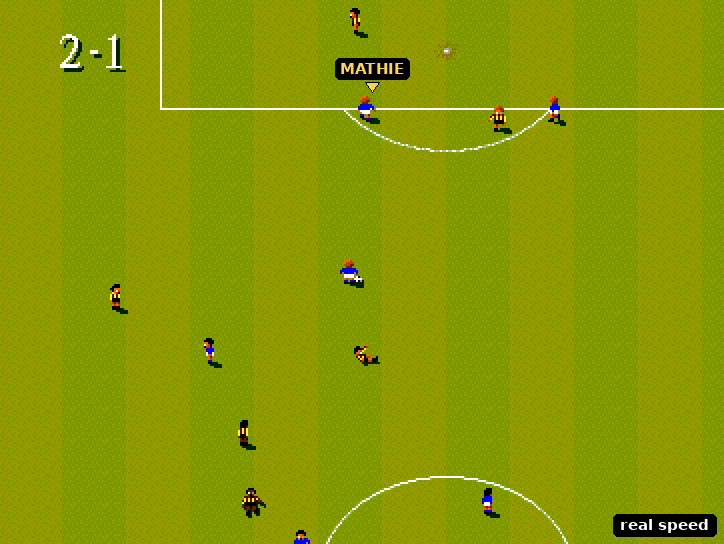

</details>

### How, what and why

**How.** Get into the Finishing zone: central (`x` 241 to 431) and less than 75 units from
the goal line, roughly from the penalty spot inwards. Shoot to one side of the keeper.

**What happens.**

| | |
|---|---|
| 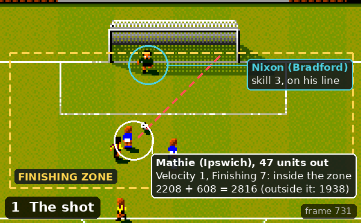 | **1. The shot.** Mathie is 47 units out, inside the zone, so his **Finishing (7)** sets the pace, not his Velocity (1): 2816, 5.5 units a frame. He kicks up-right. |
| 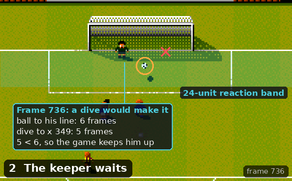 | **2. The keeper waits.** The ball enters Nixon's 24-unit band. A dive would reach the point where it will cross his line (red X) in 5 frames; the ball needs 6. So the game keeps him on his feet. |
| 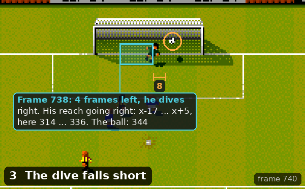 | **3. The dive falls short.** Two frames later the ball is 4 frames away and a dive needs 5: now he dives. His touch window going right runs from `x - 17` to `x + 5`, here 314 to 336. The ball is at 344. |
| 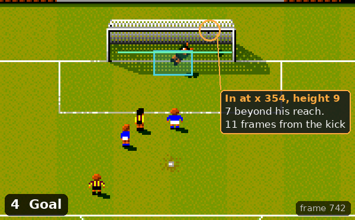 | **4. Goal.** In at `x` 354, height 9, 11 frames after the kick. |

**Why it works.**

1. **Little time.** From close in the ball needs only 11 frames to reach the line, and the
   keeper can react only in the last 6 of them.
2. **Finishing, not Velocity.** Inside the zone the shot takes the Finishing bonus. Mathie's
   Velocity is 1: the same shot from outside the zone would have left at 1938, 3.8 units a
   frame. Inside, it left 45% faster.
3. **The keeper waits as long as he can.** He dives only once a dive can no longer get there
   comfortably, as in situation 1. By then, to the side, it can't get there at all.

**Doing it yourself.** Get the ball central and close before shooting, and give it to the
player with the best Finishing. His Velocity barely matters in there. Shoot across the
keeper, not at him.

### Under the hood

**1. The kick: `PlayerKickingBall`.** Ball at `(312, 176)`. The shot test passes
(`y <= 342`, direction 1). The zone test passes (`x` 312, `y` 176 < 204), so:

```
ball.speed = 2208 + kBallSpeedFinishing[7] = 2208 + 608 = 2816     (logged)
ball.dest  = ball + (1000, -1000)          direction 1: crosses y=129 at x=359
```

**2. The curl.** The CPU's stick read 0 against the shot's 1 (`diff` 1): `leftSpin`. The
target moved up 92, 69, 46, 46... (multipliers 4, 3, 2, 2...), turning the ball towards
vertical: it crosses at `x` 354, not 359.

**3. The keeper's decision: `ShouldGoalkeeperDive`.** Nixon, skill 3, at `(320, 135)`:

| frame | ball `y` | `dy` | `framesY` | `framesX` | `framesDive` | result |
|---|---|---|---|---|---|---|
| 734 | 164 | 29 | | | | more than 24 away: no |
| 736 | 156 | 21 | 6 | 68 | 5 | 5 < 6: no dive |
| 738 | 148 | 13 | 4 | 64 | 5 | 5 >= 4: **dive** right, speed 2048 |

**4. The contact test.** Going right, his window is `keeper.x - 17 <= ball.x <= keeper.x + 5`
(`pixWidth` 16):

| frame | keeper `x` | window | ball `x`, depth | |
|---|---|---|---|---|
| 740 | 331 | 314 – 336 | 344, 5 | 8 beyond |
| 742 | 339 | 322 – 344 | 351, 4 | 7 beyond |

**5. The goal.** Frame 742, the ball at `(354, 127)`, height 9.

---

## 3. One-on-one: the point-blank roll

*Chelsea 2-1 Birmingham City, minute 83. Mark Hughes shoots from close range with the fire
button held. The ball reaches Ian Bennett, the game rolls the dice, and the keeper loses.
3-1.*

> **The fire button was held by the test rig.** This roll only runs while the attacking
> side holds fire with the ball at the keeper's feet. The CPU never does that: in 1,280 CPU
> v CPU matches the roll ran zero times. This goal comes from a batch where gdb held the
> attacker's fire button at that one moment (`tools/human_fire.gdb`), which is what a player
> who keeps fire pressed after shooting does. Everything else is the engine's own play.

<details>
<summary>The move as the game played it: from the player on the ball to the goal (real speed, then half speed from the shot)</summary>

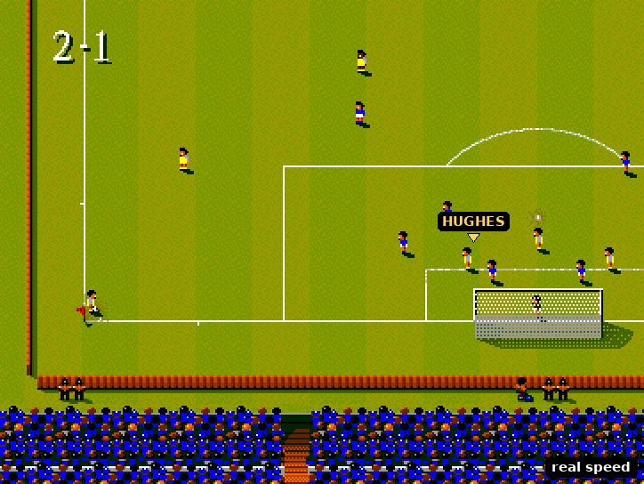

</details>

### How, what and why

**How.** Get close to the keeper and shoot, or carry the ball onto him, **holding fire**.
When the ball arrives within about 11 units of a keeper still on his feet, physics stops
and a dice roll decides.

**What happens.**

| | |
|---|---|
| 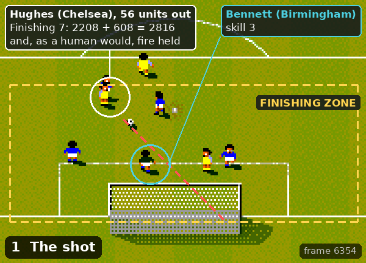 | **1. The shot.** Hughes, 56 units out, inside the zone: Finishing 7, 2816. Fire stays held. |
| 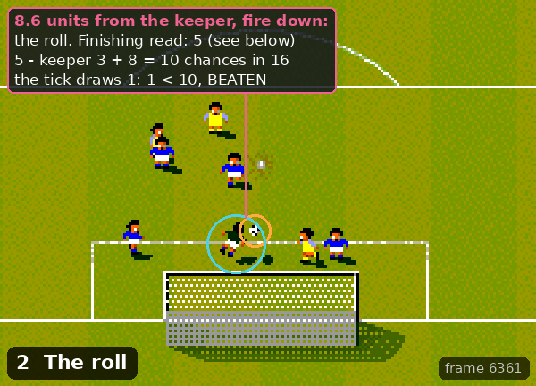 | **2. The roll.** The ball is 8.6 units from Bennett: the roll runs. The chance is (Finishing − keeper skill + 8) in 16. The Finishing it reads is **5** (see below), the keeper's skill 3: 10 in 16. The tick draws 1. Beaten. |
| 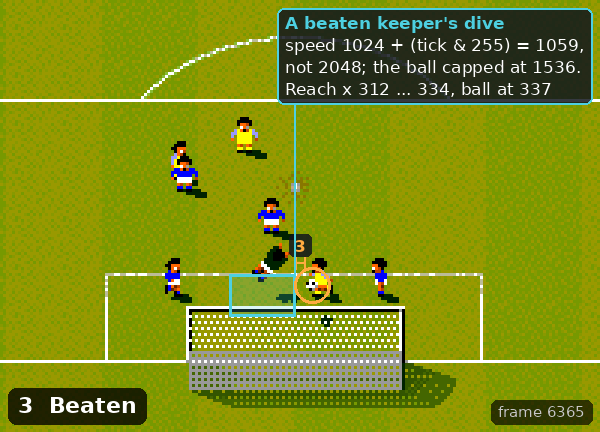 | **3. Beaten.** A beaten keeper dives towards the ball, but slowly, and the ball is slowed to at most 1536. His touch window stays 2 to 3 units short of it. |
| 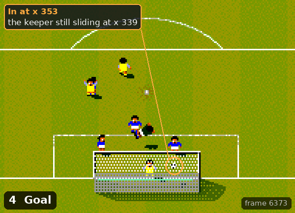 | **4. Goal.** In at `x` 353. |

**Why it works.** At point-blank range nothing the keeper does with his body counts. One
roll decides, and the attacker's Finishing against the keeper's skill sets the odds:

| Finishing − keeper | −7 | −4 | −2 | 0 | +2 | +4 | +7 |
|---|---|---|---|---|---|---|---|
| chance to beat him | 1/16 | 4/16 | 6/16 | 8/16 | 10/16 | 12/16 | 15/16 |

**The original game reads the wrong player's Finishing.** It looks up the attacker's line-up
slot in the **keeper's** squad. Hughes is Chelsea's slot 10, so the game used Birmingham's
slot 10, Paul Furlong (Finishing 5 this match), not Hughes's own 7. With Hughes's 7 it would
have been 12 in 16. OpenSWOS keeps this, because it is how SWOS plays (GAMEPLAY.md §15.3).

**Doing it yourself.** Hold fire as you shoot from close in, or as you run the ball at the
keeper. Against a weak keeper the odds are good. Against a good one, you're often better off
shooting past him from a few units further out.

### Under the hood

**1. The kick.** Ball at `(303, 713)`, attacking the bottom goal: the shot test passes
(`y >= 556`, direction 3). The zone test passes (`y` 713 >= 694): 2208 + 608 = 2816. The
straight line would cross at `x` 359.

**2. The keeper, before the roll.** Bennett, skill 3, at `(319, 744)`. His dive test says
no twice (frame 6357: `framesDive` 4 < `framesY` 6; frame 6359: 3 < 4).

**3. The roll (`update_players.c`, the keeper's update, before the dive test).** It runs
only when all of these hold:

- ball height ≤ 16,
- the keeper hasn't just saved (`goalkeeperSavedCommentTimer` ≤ 0),
- `ballDistance` ≤ 128, a squared distance, so within 11.3 units (here 74, 8.6 units),
- not `ballAbove17`,
- the attacking side's `firePressed`,
- the attacker on the ball, **or** `passKickTimer` ≥ 22. That timer is set to 25 at a kick
  and counts down each team update, so `>= 22` means a kick in the last three updates.
  Hughes's shot was 7 frames old.

```
finishing = keeper's squad [attacker's ordinal 10 - 1].finishing = 5     (Furlong, not Hughes)
idx       = finishing - goalieSkill + 7 = 5 - 3 + 7 = 9
chance    = goalScoredChances[9] = 10     (out of 16)
draw      = (tick >> 1) & 15 = (42531 >> 1) & 15 = 1
1 < 10    -> BEATEN
```

**4. Beaten.** The keeper's `goalkeeperSavedCommentTimer` goes to −5 and the attacker's
aftertouch is switched off. The ball's speed is capped at 1536 (it was about 2700). The
keeper dives towards the ball's side (right) with `GoalkeeperJumping` variant 2: speed
`1024 + (tick & 255)`, between 1024 and 1279 rather than 2048. Two frames in it was 912.

**5. The contact test.** Going right the window is `x - 17 ... x + 5`:

| frame | keeper `x` | window | ball `x`, depth | |
|---|---|---|---|---|
| 6363 | 326 | 309 – 331 | 333, 1 | 2 beyond |
| 6365 | 329 | 312 – 334 | 337, 4 | 3 beyond |

After that the ball is more than 7 units deeper than him. It crosses at `x` 353 at frame
6373.

---

## 4. Header

*Chelsea 2-1 Birmingham City, minute 62. Bennett parries Gianluca Vialli's shot, and Vialli
heads the rebound in. 3-1.*

All 16 header goals in the 1,280 matches came from a loose ball. Fourteen came straight off
the keeper's touch, as this one does, and two from a defender's clearance headed back over
a keeper still recovering from a dive. None came from a cross or a corner. Crosses and
corners go through the same header code below.

<details>
<summary>The move as the game played it: from the player on the ball to the goal (real speed, then half speed from the shot)</summary>

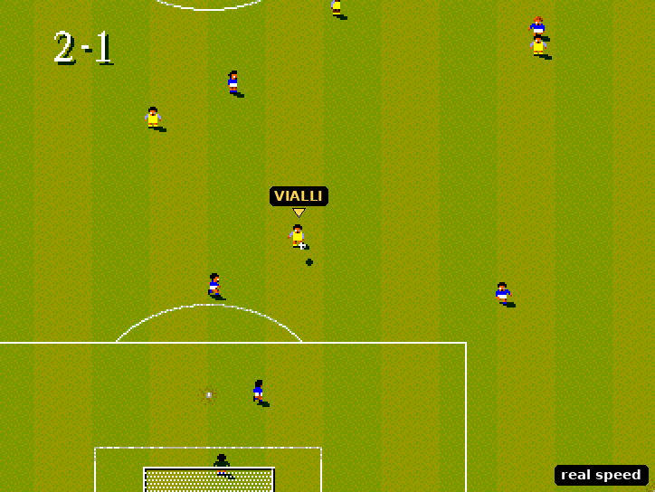

</details>

### How, what and why

**How.** Follow your shot in. If the keeper parries it, the ball comes back out in the air
in front of the goal. Head it back while he is still on the ground.

**What happens.**

| | |
|---|---|
| 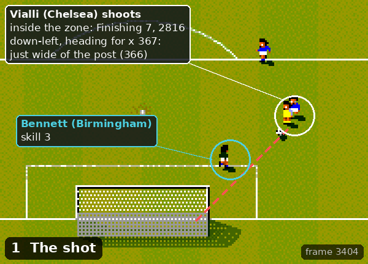 | **1. The shot.** Vialli, inside the zone: Finishing 7, 2816, down-left, heading for `x` 367, just wide. |
| 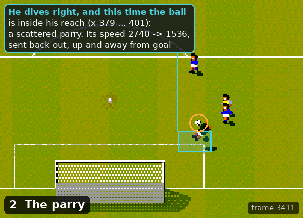 | **2. The parry.** Bennett dives right, and this time the ball *is* inside his touch window. A scattered parry sends it back out, up and away from goal, at 1536. |
| 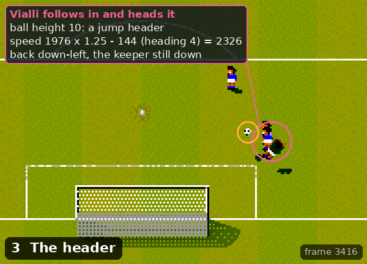 | **3. The header.** Vialli has followed in. The ball is at height 10: a jump header back down-left, while Bennett is still down. |
| 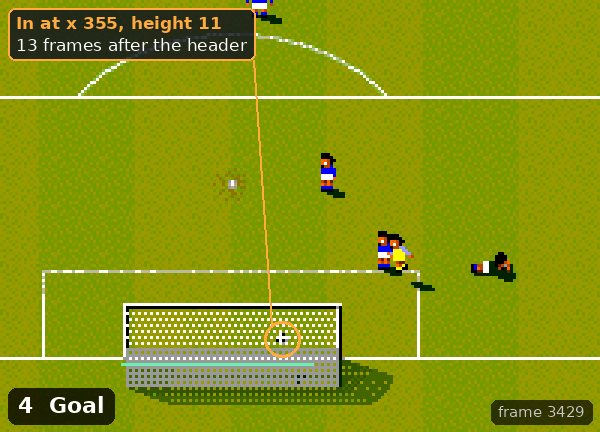 | **4. Goal.** In at `x` 355, height 11, 13 frames after the header. |

**Why it works.** A scattered parry doesn't kill the ball. It reverses its direction, so it
flies back out in front of the goal, in the air, at up to 1536. The keeper's dive keeps him
on the ground for a while, and a header from there has the goal to itself. Heading speed
comes from the header's run, not the shot.

**Doing it yourself.** After a shot, keep running in. A header aimed back the way the ball
came catches the keeper still on the floor.

### Under the hood

**1. The shot.** Ball at `(418, 718)`: zone (`x` 418 ≤ 431, `y` 718 ≥ 694), 2816, direction
5. The straight line would cross at `x` 367, one unit outside the post.

**2. The dive.** Frame 3405: `framesDive` 4 < `framesY` 5, no dive. Frame 3407: 5 >= 4, he
dives right (`ballDefensiveX` 394 > his 380), speed 2048.

**3. The contact (frame 3411).** Keeper at `x` 396, going right, so the window is 379 to 401.
The ball is at 390, depth 3, height 7: **contact**. Which outcome follows (a catch, a
controlled parry or a scattered parry) is drawn from the tick's high nibble against two
thresholds in his skill table (GAMEPLAY.md §15.5). Here it was a scattered parry:

```
destY  = ballY - (destY - ballY) + ((tick & 31) << 4) - 256    (reflected, scattered -208)
destX  = the keeper's destX
speed  = 2740 - 2740/4 = 2055   (tick bit 4 clear: no second cut)
speed  = min(speed, 1536)       logged: speed 1536, dest (1380, -454)
```

**4. The header: `PlayerHittingJumpHeader` (`src/headers.c`).** The ball takes the jump
header's lift, then:

```
ball.speed = player.speed * 1.25 = 1976 * 1.25 = 2470
           + kPlayerHeaderSpeedIncrease[heading 4] = -144   -> 2326     (logged)
```

The table runs from −336 to 0, so heading 7 adds nothing. The stick against the player's
facing decides a plain, flying or looping header and a one-step turn. The header then
halves the player's speed.

**5. The goal.** Frame 3429, `(355, 771)`, height 11.

---

## 5. Penalty

*Arsenal 2-1 Manchester City, minute 45. Dennis Bergkamp's penalty beats Eike Immel. 3-1.*

<details>
<summary>The move as the game played it: from the player on the ball to the goal (real speed, then half speed from the shot)</summary>

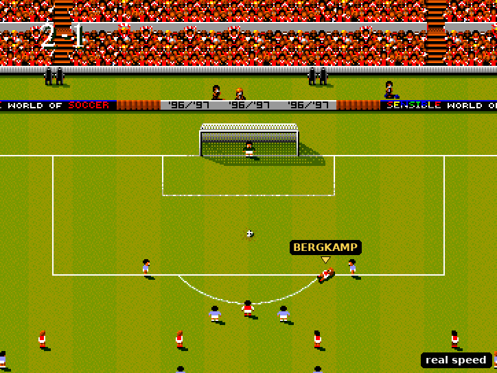

</details>

### How, what and why

**How.** Aim for a corner. The keeper doesn't move until the ball is almost on him.

**What happens.**

| | |
|---|---|
| 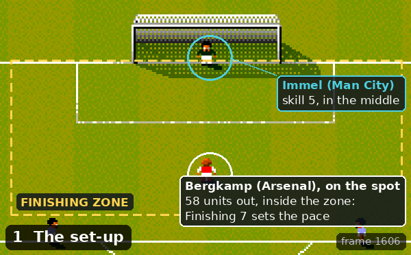 | **1. The set-up.** The spot is 58 units out, inside the Finishing zone, so Bergkamp's Finishing 7 sets the pace. Immel (skill 5) stands in the middle. |
| 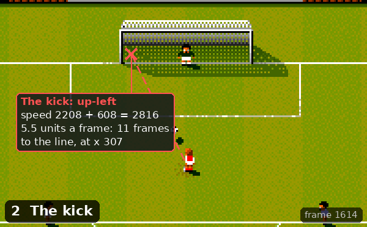 | **2. The kick.** 2816, up-left. It reaches the line at `x` 307 in 11 frames. |
| 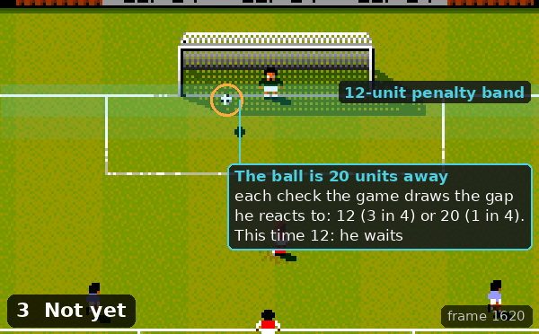 | **3. Not yet.** The ball is 20 units from him. On each check the game draws the gap he reacts to: 12 units (three times in four) or 20 (once in four). This time it drew 12, so he waits. |
| 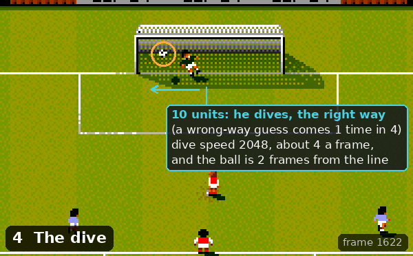 | **4. The dive.** At 10 units he dives, the right way, 2 frames before the ball reaches the line. |
| 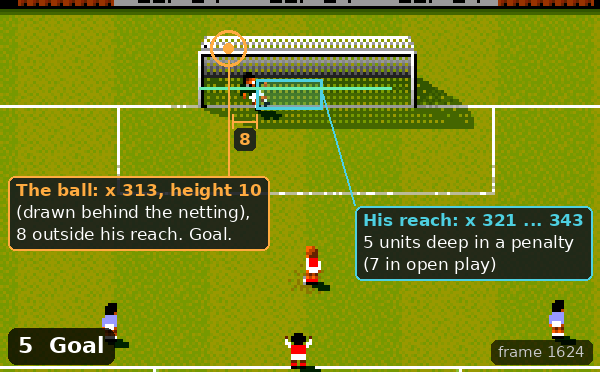 | **5. Goal.** His touch window starts at `x` 321. The ball passes at 313. |

**Why it works.** The penalty keeper reacts only once the ball is 12 units away (sometimes
20), which leaves him about 2 frames. A dive covers about 8 units in that time. The
corners are 29 units from where he stands. One time in four he also guesses the wrong way,
and then dives slower.

**Doing it yourself.** Aim at a corner: a penalty placed wide of the keeper's reach scores
almost every time. A shot close to the keeper is the only one he can stop. Shoot-outs use
the same code.

### Under the hood

**1. The kick.** State 14 (`ST_PENALTY`). The game isn't in progress, so `PlayerKickingBall`
takes the `check_throw_in` path, which only returns early for a throw-in. For anything else
it goes on to the shot test, which passes (`y` 187 ≤ 342, direction 7). The zone test
passes too (`y` 187 < 204): 2208 + 608 = 2816. The penalty's kick table aims diagonals at
half the open-play angle: target `ball + (-500, -1000)`, crossing at `x` 307.

**2. The penalty gate: `ShouldGoalkeeperDive`.** In a penalty it replaces the frame sums
with a single distance test: dive when `dy` ≤ the limit, with `limit = (Rand() & 0x18) ? 12 : 20`.

| frame | ball `y` | `dy` | result |
|---|---|---|---|
| 1616 | 171 | 40 | no |
| 1618 | 161 | 30 | no |
| 1620 | 151 | 20 | no: the limit drawn was 12 |
| 1622 | 141 | 10 | **dive** |

**3. The side.** `ballDefensiveX` 313 < his 334, so he dives left. In a penalty, if
`(tick & 0xC) == 0` he flips to the wrong side with the slower variant 1 (1280). Here tick
3110 & 0xC = 4, so no flip. Variant 0, `ballDistance` 389 > 128: speed 2048.

**4. The contact test.** A penalty's depth window is ±5 (open play ±7). At frame 1624 the
keeper is at `x` 326, going left: window 321 to 343. The ball is at 313, 8 short, depth 0.
In at `(311, 126)`, height 10.

---

## 6. Direct free kick

*Manchester City 2-1 Barnsley, minute 49. Steve Lomas curls a free kick from the edge of
the box past David Watson. 3-1.*

Rare: 10 of the 884 goals came straight from a free kick, and most of those were long lobs
from deep, like situation 7. Of 181 free kicks near goal in the first 400 matches, 54 were
shots and none went in. This is one of the few from the edge of the box.

<details>
<summary>The move as the game played it: from the player on the ball to the goal (real speed, then half speed from the shot)</summary>

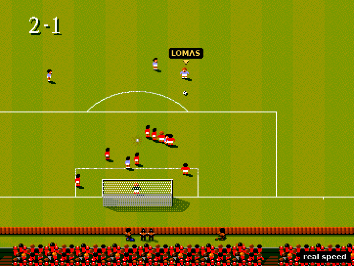

</details>

### How, what and why

**How.** A free kick in shooting range is a shot like any other: aim, then curl it with
aftertouch. Keep it low.

**What happens.**

| | |
|---|---|
| 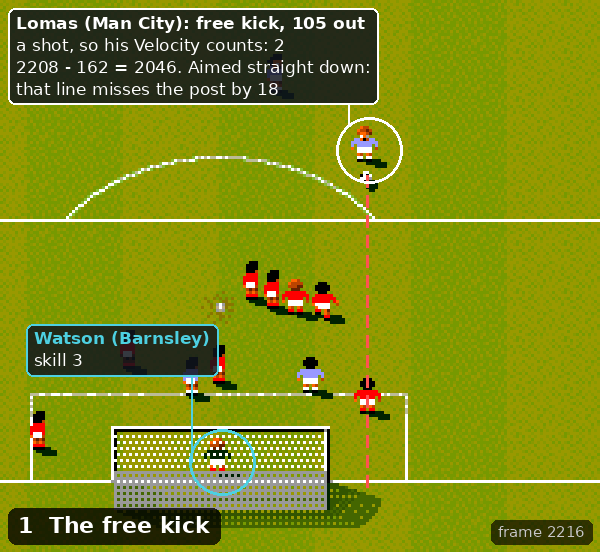 | **1. The free kick.** Lomas, 105 units out. It counts as a shot, so his Velocity matters, and it is 2: 2208 − 162 = 2046, a weak shot. Aimed straight down, it would miss the post by 18. |
| 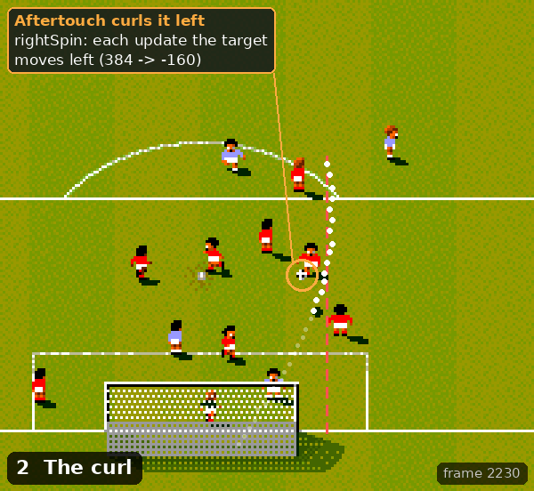 | **2. The curl.** Aftertouch moves its target left each update, and the ball bends in towards the far post. |
| 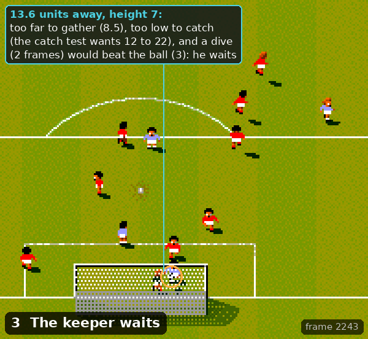 | **3. The keeper waits.** The ball is 13.6 units away at height 7. That's too far to pick up and too low to catch, and a dive would still beat the ball, so he waits. |
| 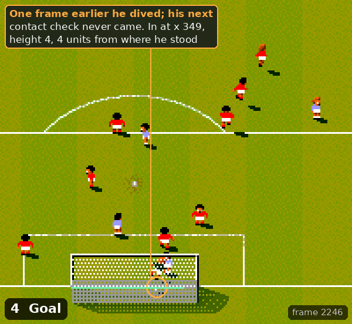 | **4. Goal.** He dives one frame before it arrives, too late for a contact check. In at `x` 349, height 4, four units from where he stood. |

**Why it works.**

1. **A low ball can't be caught.** The catch test wants the ball to reach the keeper at a
   height between 12 and 22. Below that only a dive can stop it.
2. **The keeper waits for the last moment** (as in situations 1 and 2), and here the last
   moment came one frame too late. He dived on frame 2245, the ball crossed on 2246, and his
   next contact check would have been on 2247.
3. **Curl beats the wall and the angle.** The kick's straight line was going wide. The
   aftertouch brought it back inside the post.

**Doing it yourself.** Shoot, don't pass. Curl it towards the far post and keep it low. Even
a weak shot works if it stays under catching height and the keeper leaves his dive late.

### Under the hood

**1. The free kick.** The foul at `(384, 664)` was inside the bottom goal's free-kick band
(`y` 567 to 682), so the game picked one of seven free-kick states by `x`: state 8,
`ST_FREE_KICK_LEFT3` (`game_timers.c`).

**2. The kick.** Not in progress, not a throw-in: on to the shot test, which passes (`y` 664
≥ 556, direction 4). The zone test fails (`y` 664 < 694), so `kBallSpeedKicking[2]` = −162:
2046.

**3. The curl.** The CPU's stick read 5 against direction 4 (`diff` 7): `rightSpin`.
`kKickSpinFactor[dir 4, right]` is (−32, 0):

```
step         1     2     3     4     5     6     7     8     9
multiplier   4     3     2     2     2     2     1     1     1
destX      256   160    96    32   -32   -96  -128  -160  -192     (from 384)
```

At step 4 the stick (5) against the kick (4) is `diff` 7, so no chip arm fires and the
shot's speed is untouched.

**4. The keeper: `ShouldGoalkeeperDive`.** Watson, skill 3, edges right from `x` 339 to 345.

| frame | `dy` | `framesY` | `framesDive` | result |
|---|---|---|---|---|
| 2239 | 20 | 7 | 3 | no dive |
| 2241 | 14 | 5 | 2 | no dive |
| 2243 | 8 | 3 | 2 | no dive |
| 2245 | 1 | 1 | 2 | **dive** right, near jump 1024 (`ballDistance` 50) |

At frame 2243 the no-dive path runs the catch test. The ball would reach him lower than
height 7, at most 12, so no catch. Its `ballDistance` 185 is over 72, so he can't gather
it either. A dive skips both tests, and the ball crossed at frame 2246, `(349, 771)`,
height 4.

---

## 7. Chip

*Leeds United 2-2 Ipswich Town, minute 71. Lee Sharpe's long ball from the right wing turns
into a chip at aftertouch step 4. It bounces in the box and drops in over Craig Forrest.
3-2.*

All 8 chips in the 1,280 matches were this kind: a long ball from a wing near halfway that
the aftertouch's HIGH arm turned into a lob.

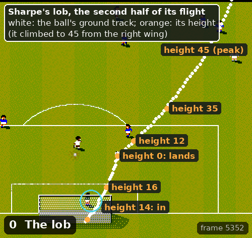

<details>
<summary>The move as the game played it: from the player on the ball to the goal (real speed, then half speed from the shot)</summary>

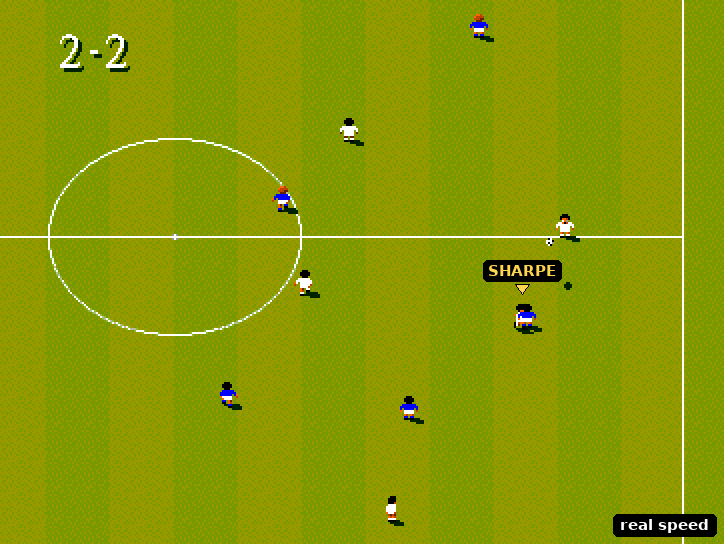

</details>

### How, what and why

**How.** Kick, then pull the stick **back against the kick** (`diff` 3 to 5) at aftertouch
step 4. The ball is re-kicked high: speed 2688 (¾ of it if kicked straight up or down the
pitch, ⅞ on a diagonal), lift 2.0.

**What happens.**

| | |
|---|---|
| 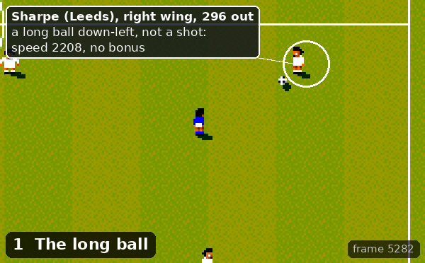 | **1. The long ball.** Sharpe, on the right wing, 296 units out. It isn't a shot (too far), so it leaves at a plain 2208. |
| 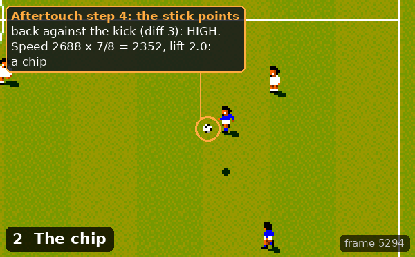 | **2. The chip.** At step 4 the stick points back against the kick: the HIGH arm. 2352 and lift 2.0. It climbs to height 45. |
| 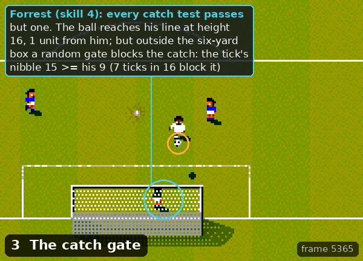 | **3. The catch gate.** It lands 59 units out and bounces up to 16. Forrest is in line and every catch test passes but one: outside the six-yard box, a random gate blocks the catch. |
| 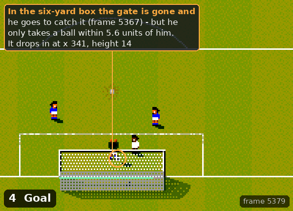 | **4. Goal.** Inside the six-yard box he finally goes to catch it, but he only takes a ball within 5.6 units of him. It drops in at `x` 341, height 14. |

**Why it works.** A high ball can't be dived at (contact needs height ≤ 20) or caught
(height ≤ 22). By the time it comes down, the keeper has to pass a random gate before he
may even try a catch outside the six-yard box, and it blocks 7 ticks in 16 for this keeper.
Once it's inside the box he tries, but he has to be right under it, within 5.6 units.

**Doing it yourself.** Pull back on the stick about a fifth of a second after kicking. From
long range, aim the lob to drop just in front of the six-yard box: that is where the gate
is still on.

### Under the hood

**1. The kick.** `(536, 473)`, direction 5. `y` 473 < 556, so it isn't a shot: 2208.

**2. The aftertouch.** The CPU's stick read 2 against direction 5 (`diff` 3): `leftSpin`,
target moved by `kKickSpinFactor[dir 5, left]` = (0, +23) × the multipliers. At step 4 the
chip test reads the stick once: `diff` 3 is in 3 to 5, the **HIGH** arm:

```
ball.deltaZ = kHighKickDeltaZ = 2.0
ball.speed  = kHighKickBallSpeed = 2688
direction 5 is odd:  speed = speed - speed/4 + speed/8 = 2352   (logged 2332 one update on)
```

A centred stick, or `diff` 2 or 6, takes the NORMAL arm instead (2560, lift 1.375).

**3. The flight.** Height 45 at frame 5316, landing at `(378, 710)` at frame 5352, a bounce
to 18.

**4. The catch test (`goalie_can_catch_checks`, logged at every keeper update).** The test
fails as soon as one of its checks does:

| frame | in 6-yd box | tick nibble vs his 9 | landing point | height at his line | `ballDistance` | result |
|---|---|---|---|---|---|---|
| 5345 | no | 8: passes | yes | 0 | 6948 | fails: too low |
| 5353 | no | 10: **blocks** | none | 15 | 3501 | fails |
| 5359 | no | 13: **blocks** | none | 16 | 1898 | fails |
| 5365 | no | 15: **blocks** | 334 | 16 | 850 | fails on the gate alone |
| 5367 | **yes**: gate skipped | 15 | 337 | 16 | 521 | **passes** |

At frame 5367 `GoalkeeperCaughtTheBall` puts him in his catching pose, and his save routine
stops running. In that pose he takes the ball only when it comes within 32 of him (squared,
so 5.6 units, height ignored). He never logged a catch or a parry, so it never did. Goal at
frame 5379, `(341, 770)`, height 14.

---

## 8. Rebound

*Derby County 2-1 Crystal Palace, minute 61. Chris Day parries Marco Gabbiadini's shot, and
Dean Sturridge scores the rebound. 3-1.*

105 of the 884 goals were rebounds, the third most common kind.

<details>
<summary>The move as the game played it: from the player on the ball to the goal (real speed, then half speed from the shot)</summary>

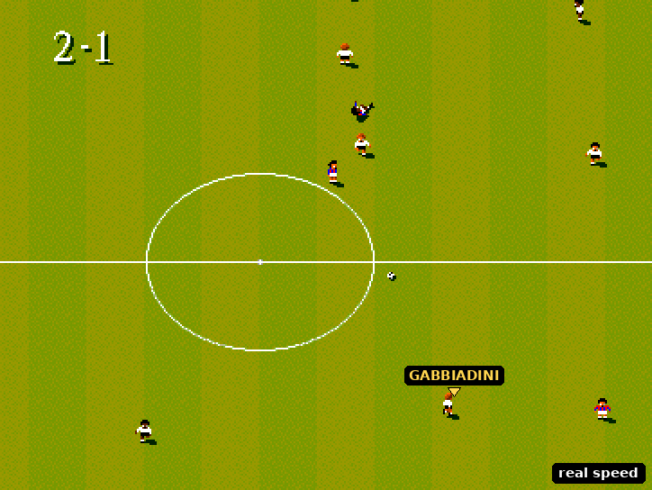

</details>

### How, what and why

**How.** Have a second attacker follow every shot in. A parry sends the ball back out in
front of goal, slower, while the keeper is on the ground.

**What happens.**

| | |
|---|---|
| 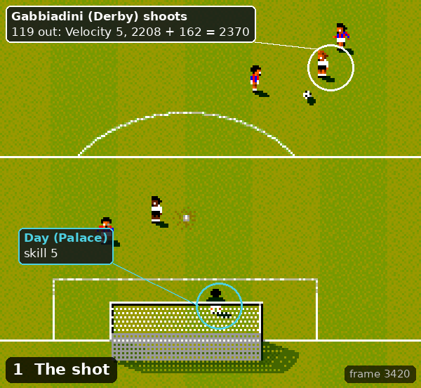 | **1. The shot.** Gabbiadini, 119 units out: Velocity 5, 2370. |
| 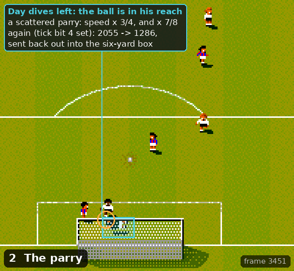 | **2. The parry.** Day dives left and the ball is inside his reach: a scattered parry. ¾ speed, then ⅞ again: 2055 becomes 1286, sent back out into the six-yard box. |
| 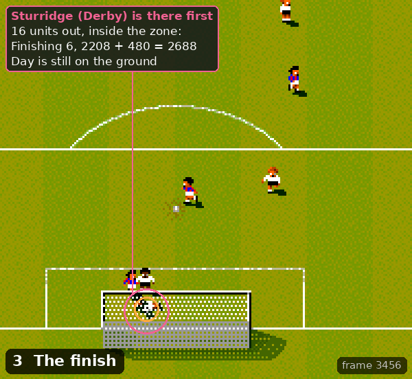 | **3. The finish.** Sturridge gets there first, 16 units out, inside the zone: Finishing 6, 2688. Day is still on the ground. |
| 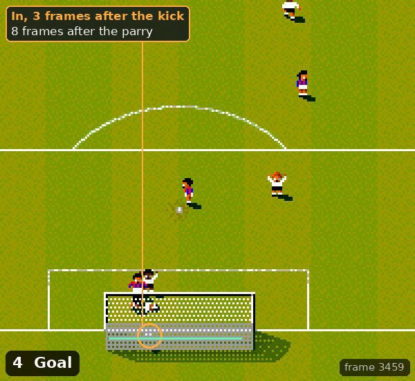 | **4. Goal.** In 3 frames after the kick, 8 after the parry. |

**Why it works.** A parry doesn't end the danger. A scattered parry reverses the ball and
sends it back out at no more than 1536 (here 1286). The diving keeper stays down while a
rebound shot from inside the zone, at full Finishing speed, needs only 3 frames.

**Doing it yourself.** Shoot, then switch to the nearest runner and get into the six-yard
box. Strike the loose ball first time.

### Under the hood

**1. The shot.** `(400, 650)`, direction 5: a shot, outside the zone (`y` 650 < 694), so
2208 + `kBallSpeedKicking[5]` (162) = 2370.

**2. The dive.** Frame 3445: `framesDive` 5 < `framesY` 7, no dive. Frame 3447: 5 >= 5, he
dives left, speed 2048.

**3. The contact (frame 3451).** Keeper at `x` 324, going left: window 319 to 341. The ball is
at 322, depth 2, height 4: contact. The tick's high nibble (25082: 15) falls in the
scattered band:

```
speed = 2055 - 2055/4 = 1542
tick & 0x10 is set:  speed -= (2055/4)/2   -> 1286      (logged)
destY reflected around the ball, scattered by ((25082 & 31) << 4) - 256 = +160
destX = the keeper's destX                               logged dest (-660, -404)
```

**4. The finish.** Sturridge at frame 3456 from `(321, 753)`: a shot (direction 4), inside
the zone: 2208 + 480 = 2688. 16 units to the line: in at frame 3459.

---

## 9. Own goal

*Derby County 2-2 Crystal Palace, minute 87. Day gets a touch to Gabbiadini's shot. The
loose ball runs along the goal line to Andy Roberts at his own post and goes in off him.
3-2 to Derby.*

All 3 own goals in the 1,280 matches came after the keeper had touched the ball.

<details>
<summary>The move as the game played it: from the player on the ball to the goal (real speed, then half speed from the shot)</summary>

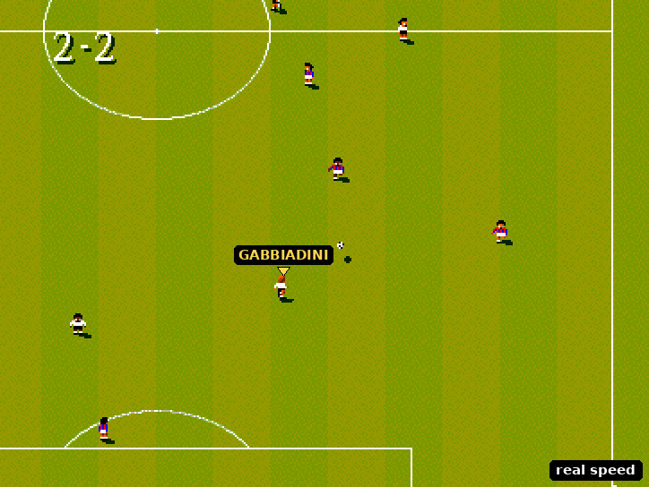

</details>

### How, what and why

**How (for the other side).** A loose ball by the goal line, and a defender who gets to it
facing his own goal.

**What happens.**

| | |
|---|---|
| 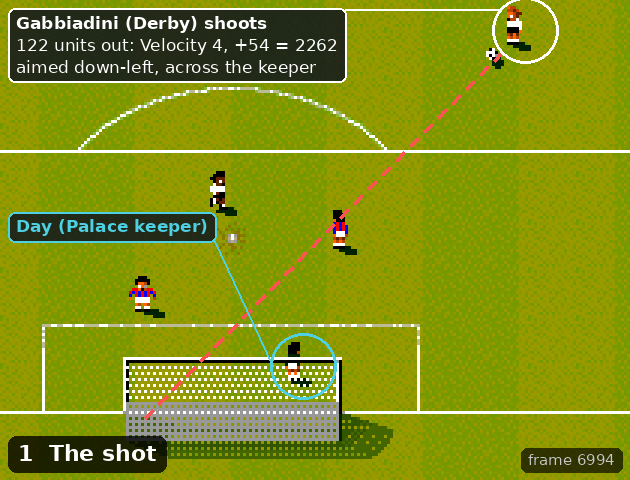 | **1. The shot.** Gabbiadini, 122 units out: Velocity 4, 2262, across Day. |
| 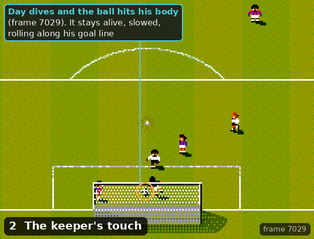 | **2. The keeper's touch.** Day dives and the ball hits his body. It stays alive, slowed, rolling along his goal line. |
| 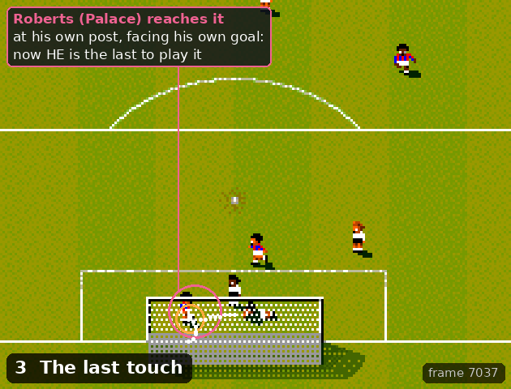 | **3. The last touch.** Roberts reaches it at his own post, facing his own goal. Now **he** is the last player to have played it. |
| 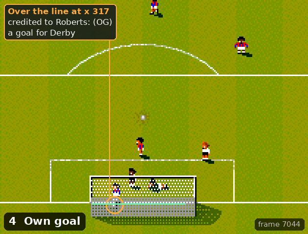 | **4. Own goal.** Over the line at `x` 317. Credited to Roberts (OG), a goal for Derby. |

**Why it counts as an own goal.** The game credits a goal to whoever played the ball last,
with one exception: a keeper. If it had gone straight in off Day, the goal would have been
Gabbiadini's. Roberts touched it after Day, and he plays for the side that conceded.

### Under the hood

**1. The shot.** `(429, 647)`, direction 5, outside the zone: 2208 + 54 (Velocity 4) = 2262.

**2. The touch.** Day (skill 5) dives left at frame 7027. His `ballDistance` is 97, under
128, so it's the near jump at 1024. At frame 7029 he is at `x` 343, window 338 to 360. The
ball is at 339, one unit inside, depth 3: contact. (This match was recorded before the parry
probes existed, so its outcome isn't logged: the ball stayed by the line, slowed.) It rolls
left along the line at about 2.4 units a frame, reaches Roberts by the post at frame
7036–7037, and crosses at `x` 317 at frame 7044.

**3. Who scored: `handleGoalScored` (`game_timers.c`) and `GoalScored` (`goal_scored.c`).**

```
scorer = _lastPlayerPlayed
if (scorer is a keeper && _lastKeeperPlayed)  scorer = _lastKeeperPlayed   (the player before him)
goalType = (scorer->teamNumber != scoringTeam) ? GT_OWN_GOAL : GT_NORMAL
if (_penalty) goalType = GT_PENALTY
```

Logged: scoring team 1 (Derby), scorer's team 2 (Palace), line-up slot 4: Andy Roberts.

---

## 10. Central shot, bent past the keeper

*SWOS 2020, team training: Lazio against the training side, in its AMIGA (60FPS) style. A
Lazio player, played by a person, runs up the middle and shoots from 110 units, straight at
the keeper, then bends the ball left past him. 1-0.*

> **A human's goal, from SWOS 2020's replay.** OpenSWOS did not play this one and nothing
> logged it. It comes from SWOS 2020's own replay of the move (`LATEST.RPL`), which keeps
> only where each sprite was drawn, so its positions are measured, to about 2 units. Its
> AMIGA (60FPS) style runs the Amiga's ball and keeper code 60 times a second, with movement
> scaled so a second covers the same ground (docs/DOS_GAMEPLAY.md §10): a frame here is a
> sixtieth of a second. The engine's side, under the hood, is a CPU goal of the same kind
> that OpenSWOS logged: Hughes against Bennett, kicked from almost the same spot and in at
> the same point.

The CPU scores this way often. 101 of the 494 long shots in the pool were kicked within 14
units of the middle and 80 or more out, and 98 of those were bent with aftertouch.

<details>
<summary>The move as the game played it: from the player on the ball to the goal (real speed, then half speed from the shot)</summary>

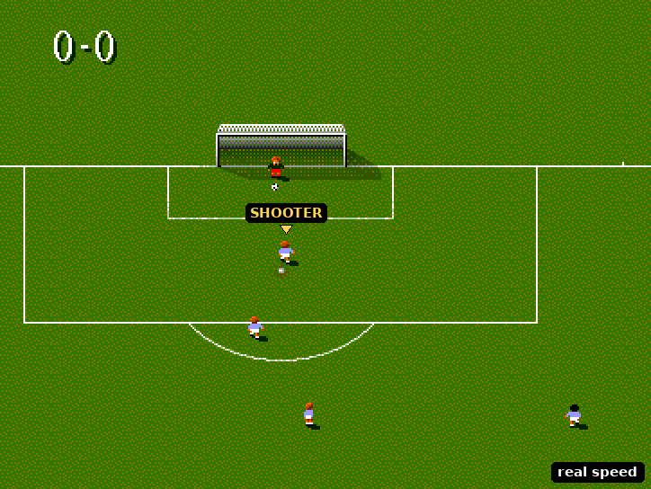

</details>

### How, what and why

**How.** Run at goal through the middle and shoot from outside the box, straight at the
keeper. Then bend it: hold the stick diagonally forward towards the side you want (up-left
here), at once or within a few frames.

**What happens.**

| | |
|---|---|
|  | **0. The run.** He has the ball for 3.3 seconds. He picks it up by the six-yard box, carries it out to 206 units, turns, and comes back up the middle. |
|  | **1. At the keeper.** He shoots from 110 units out, 7 right of the middle, straight up the pitch (red). The keeper stands in line with it. |
|  | **2. The bend.** The ball flies straight for 8 frames. Then the aftertouch bends it left, a little more each frame, until it is 24 units off its line at the goal. The keeper only shuffles after it: 2 units in 18 frames. |
|  | **3. Too late.** He dives 4 frames before the ball reaches the line. It is already 5 units to his left and 6 in front of him, at height 12. |
|  | **4. Goal.** It crosses at `x` 317, height 10: 17 units left of where he stood and 15 inside the post. |

**Why it works.**

1. **A ball coming at the keeper does not make him dive.** He dives only once a dive is the
   only way to get there in time. While the ball heads at him, a step or two is enough, so
   he steps.
2. **The bend moves the target after that.** Each update it shifts the point where the
   ball will cross his line. He follows on foot, much slower than the point moves.
3. **When he has to dive, the ball is too close for a full dive.** At a ball within about 11
   units a keeper dives at half speed. In the logged twin below he dived 3 frames from the
   line and came up 2 units short.
4. **Unlike situation 1, it does not need the far corner.** There, a dive that started in
   time could not cover the distance. Here the ball passes close to where the keeper stood,
   and it beats him on timing: the dive comes too late, and slowly.

**Doing it yourself.**

- Shoot towards the goal, then bend. The first stick direction that differs from the
  shot's (but is not straight back) sets the spin for the rest of the aftertouch window. The
  sooner you set it, the bigger the bend: the first updates count ×5, ×4, ×3.
- Hold it **diagonally forward**. At aftertouch step 4 (the fifth update after the kick) the
  game checks the stick once. Diagonally forward leaves the shot alone. Straight across, or no
  direction, re-kicks it slower (¾ of 2560 for a shot straight up) and higher. Pulling back
  makes it a chip. This shot's height, a peak of 13, is a plain shot's, so it was not
  re-kicked.
- Start from the middle. From the side the keeper's dive starts in time and only the far
  corner beats it (situation 1). From the middle the bend beats his timing.

### Under the hood

**1. Measured from the replay** (60 frames a second; the ball from its sprite and its
shadow, `tools/rpl.py`; the keeper from his sprite):

| frame | after the kick | ball `x, y`, height | keeper `x` | |
|---|---|---|---|---|
| 3424 | 0 | 341, 239, 0 | 334 | the kick, straight up |
| 3432 | 8 | 341, 208, 8 | 333 | still on its line |
| 3436 | 12 | 339, 192, 10 | 333 | the bend shows |
| 3440 | 16 | 335, 177, 12 | 332 | |
| 3444 | 20 | 330, 163, 13 | 331 | the highest point |
| 3448 | 24 | 325, 149, 12 | 329 | |
| 3450 | 26 | 322, 142, 12 | 327 | **he dives** |
| 3452 | 28 | 320, 136, 10 | 324 | |
| 3454 | 30 | 317, 129, 10 | 321 | over the line |

The flight took half a second, the ball slowing from about 3.9 to 3.6 units a frame. The
keeper moved 7 units before his dive.

**2. The same shot in OpenSWOS, logged: pool match 796** (Chelsea 2-1 Birmingham City,
minute 44, 50 frames a second). Mark Hughes shoots from `(341, 225)`, 96 out and 7 right of
the middle. Ian Bennett, skill 3, is at `x` 330 and steps across to 336, in line with it. It goes
in at `(317, 127)`, height 10, just as the human's did.

The kick (`PlayerKickingBall`): outside the Finishing zone (`y` 225 is not < 204), so

```
ball.speed = 2208 + kBallSpeedKicking[velocity 7] = 2208 + 384 = 2592
ball.dest  = (341, -775)                          direction 0: straight up
```

The bend (`ApplyBallAfterTouch`, `src/ball_physics.c`). At step 1 the stick reads 7
(up-left) against the shot's 0: `diff = (0 - 7) & 7 = 1`, which sets `leftSpin`. From then
on every update moves the target by `kKickSpinFactor[direction 0, left]` = `(-32, 0)` times
the step's multiplier:

```
step          1     2     3     4     5     6     7     8     9
multiplier    4     3     2     2     2     2     1     1     1
destX       213   117    53   -11   -75  -139  -171  -203  -235
```

At step 4 the stick reads 7 again, `diff` 1: neither the NORMAL arm (2 or 6, or no
direction) nor the HIGH arm (3 to 5). The shot keeps its speed and lift.

The keeper (`ShouldGoalkeeperDive`, `src/goalkeeper.c`). On each of his updates he works out
`defX`, where the ball will cross his line on its current heading. The bend drags it left
much faster than he walks:

| frame | 788 | 790 | 792 | 794 | 796 | 798 | 800 | 802 |
|---|---|---|---|---|---|---|---|---|
| `defX` | 341 | 334 | 332 | 329 | 326 | 325 | 324 | 323 |
| keeper `x` | 336 | 336 | 336 | 335 | 334 | 334 | 333 | 332 |

Once the ball is within 24 units, the dive test runs:

```
frame 798:  framesY 6, framesX 24, framesDive 3    3 < 6: a dive would make it, no dive
frame 800:  framesY 4, framesX 24, framesDive 2    2 < 4: no dive
frame 802:  framesY 2, framesX 24, framesDive 2    2 >= 2: DIVE
```

That is the rule from situation 1 (GAMEPLAY.md §15.3): he dives only when the modelled dive
would no longer comfortably beat the ball. Here that is 3 frames before the line.

The dive (`GoalkeeperJumping`): direction 6 (left), variant 0. `keeper.ballDistance` is 98,
not more than 128 (the ball is within about 10 units), so the speed is
`kGoalkeeperNearJumpSpeed` = **1024**, half the far dive's 2048.

The contact test (frame 804): the keeper is at `x` 328, speed 912. Going left, his window is
`x - 5 < ball.x < x + 17`, so 323 to 345. The ball is at `(321, 135)`, height 10: the right
depth (2) and height, but **2 units short** of the window. At frame 805 it is in.

---

## 11. Long shot from the side: where to stand, where to aim

*SWOS 2020, team training: Barcelona against the training side, in its AMIGA (60FPS) style. A
Barcelona player, played by a person, shoots from the right, 166 units out, on the diagonal.
He bends it in and lets the stick go at the fifth update, which lifts it. It drops in 14
inside the far post. 1-0.*

Situation 1 is the same family: a long shot from the side, curled towards the far post. This
one is lifted too, and from further out. More to the point, this section answers the
question behind both: **from where, and aimed where, does a shot from the side score most?**
That was measured, not guessed.

> **The shot lab.** OpenSWOS played the shot itself, as a person would: a gdb script holds
> the attacker's joystick (`tools/shotlab.py`), puts him and the ball on a spot in SHOOTING
> PRACTICE (a keeper alone), lets the keeper settle, then pushes the stick, holds fire until
> the shot goes, and plays an aftertouch technique. Everything after that is the game's: 11
> distances x 9 widths x 18 techniques x 10 tries, then finer sweeps, about 32,000 shots,
> against a skill-4 keeper (skills 2 and 6 checked). The shooter's shooting and finishing are
> 6. The person's own goal is measured from SWOS 2020's replay, as situation 10's is.


<details>
<summary>The move as the game played it: from the player on the ball to the goal (real speed, then half speed from the shot)</summary>


</details>

### How, what and why

**Where to stand: on the line.** A shot can only go in one of 8 directions, so from the side
the aim is decided by where you stand. Kicked on the diagonal, the ball sets off along a
45-degree line, and that line meets the goal line at `x - y + 129`. The best spots are the
ones whose line meets it **24 units inside the far post** (`x` 326 from the right). On that
line (green), a plain diagonal kick, with the stick held on the diagonal and no bend, scored:

| distance out | 71 | 101 | 131 | 161 | 191 |
|---|---|---|---|---|---|
| goals in 20 (skill-4 keeper) | 95% | 80% | 80% | 95% | 25% |
| skill-6 keeper (10 each) | 78% | 60% | 33% | 70% | 0% |

To find the line in a match: from the right it crosses the front edge of the box 65 units in
from its corner, and the box's side line 65 units beyond the front edge. From the left it is
the mirror, but the best point is a little nearer the post: **16 inside the far post** (`x`
350). That line crosses the front edge and the side line 70 units from the corner, and scores
60 to 90% to 161 out.


**Where to aim: a third of the goal in from the far post.** The aim picture pools every
distance from 71 to 161 out. Lines that meet the goal line at 326 scored 88%. Lines between
the post and 322 scored 34 to 57%, and any nearer the keeper fell to almost nothing. What
counts is the distance from where the keeper stood when the ball was kicked. Over all the
diagonal shots in the lab, those that went in 25 to 54 units from him scored 40 to 53%, and
those within 20 units of him under 6%. Standing off his near post, he covers his own half of
the goal and a little more.

**Off the line: bend it in.** Further from the middle than the line (as in this goal), the
straight line misses the far post, and aftertouch has to bring it back. Push the stick
straight forward (up, for a diagonal kicked up-left). How much it bends depends on when you
start, and on the distance:

| distance out | bend from update 1 | 2 | 3 | 4 | 5 | 6 | 7 |
|---|---|---|---|---|---|---|---|
| 80-119 | 35 | 30 | 23 | 20 | 13 | 10 | 8 |
| 120-159 | 49 | 44 | 33 | 31 | 24 | 19 | 13 |
| 160-199 | 70 | 58 | 47 | 40 | 34 | 25 | 19 |

(Units the crossing point moves towards the goal: the median of the lab's shots.) Pick the
start that moves your line to about 24 inside the far post.

**From far out, let go at step 4: the lift.** At the fifth update the game checks the stick
once. Letting go (or pushing straight across) re-kicks the ball higher (lift 1.375 a frame)
and at a fixed 2560, which is 2240 for a diagonal. From close in that is a mistake: from 101
out or nearer, lifted shots scored 0 to 11%, because the ball is slower and comes in at a
height the keeper catches. From 130 out or further it is what wins. From this goal's own spot:

| from (416, 295), on the diagonal | goals |
|---|---|
| bend from update 2, let go at step 4 | **90%** (27 of 30) |
| bend from update 1, let go at step 4 (this goal) | 53% |
| bend from update 2, no let-go | 43% |
| bend from update 1, no let-go | 10% |
| anything else (18 techniques tried) | 0 to 17% |

**What happens in this goal.**

| | |
|---|---|
|  | **2. Wide of the post.** He shoots from 166 out, 82 right of the middle, on the diagonal. Its straight line (red) would meet the goal line at `x` 250, 52 units wide of the far post. The keeper stands off his near post. |
|  | **3. Bent and lifted.** He bends it in from the first update. At the fifth (frame 698) the ball slows (from about 2,390 to 2,190) and keeps climbing: the re-kick. It peaks at 24, and is still in the air when it reaches the keeper. |
|  | **4. Too late.** He dives 5 frames before the line, with the ball still flying fast, 14 high and 7 units to his left. |
|  | **5. Goal.** It crosses at `x` 316, height 6: 14 inside the far post. |

**Why it works.**

1. **Close to the far post is far from the keeper.** From the side he stands off his near
   post. A ball 24 inside the far post goes in 25 to 54 units from him, beyond what his dive
   covers in the frames he has (situation 1).
2. **The lift keeps the pace.** In the air the ball loses 10 speed a frame. On the ground it
   loses 16, plus the pitch's own drag. From far out, a plain shot lands and rolls before it
   reaches the keeper. The lifted one is still flying, so it arrives faster, even though the
   re-kick slowed it.
3. **A faster ball means a later dive.** The keeper weighs a dive only once the ball is within
   24 units, and dives when the modelled dive would no longer comfortably beat it. A faster
   ball reaches that point with fewer frames to spare, so he dives later and comes up short.

**Doing it yourself.**

- **Can you pick your spot?** Get onto the green line, 70 to 160 out. Kick on the diagonal
  and hold the stick there through the aftertouch (letting go re-kicks it). No bend needed.
- **Wider than the line?** Bend it in, starting so the table above brings your line to about
  24 inside the far post.
- **More than 130 out?** Also let go of the stick at the fifth update, about a fifth of a
  second after the kick. Before that, hold the bend.

### Under the hood

**1. Measured from the replay** (60 frames a second; `tools/rpl.py`):

| frame | after the kick | ball `x, y`, height | |
|---|---|---|---|
| 686 | 0 | 416, 295, 0 | the kick, on the diagonal |
| 698 | 12 | 388, 258, 10 | the fifth update: the re-kick |
| 714 | 28 | 360, 209, 24 | the highest point |
| 738 | 52 | 323, 142, 14 | **he dives** |
| 743 | 57 | 316, 129, 6 | over the line |

The NORMAL re-kick explains the height. A plain shot's lift (1.25 a frame) peaks at about
11. A fresh 1.375 a frame at height 10, under the game's gravity of about 0.071, adds 13.3,
which gives a peak of 23.3. The replay shows 24. The speed drop from about 2,390 to 2,190
matches a re-kick to 2,240 for a diagonal (2560 x 7/8).

**2. The lab twin: this shot from (416, 295), logged** (OpenSWOS, 50 frames a second,
`LAB_TRACE=1`). The two techniques that bend from update 2, with and without the let-go.

The aftertouch (`ApplyBallAfterTouch`). The stick moves from 7 to 0 (up) at step 1, `diff 7`,
which sets `rightSpin`. Each update then moves the target up by 23 x the step's multiplier:
`destY` -704, -796, -865, -911, ... At step 4 the stick reads -1 (let go), so this is the
NORMAL arm:

```
ball.speed  = 2560 - 640 + 320 = 2240     (direction 7: x 7/8; it was 2373)
ball.deltaZ = 0x16000 = 1.375 a frame     (it was 0.55 and falling)
```

The keeper (`ShouldGoalkeeperDive`, `GoalkeeperJumping`), from the kick at 2478:

```
                 dive decided       framesY  framesDive  ball speed  ball height
let go:          41 frames after    4        9           1930        16
no let-go:       37 frames after    8        8           1763         1
```

Without the let-go, the ball has landed by the time it reaches him and rolls slower, so he
dives with 8 frames to spare. His body (window `x - 5` to `x + 17`) meets it: parried. With
the let-go it reaches him at 1930, in the air, and he dives with 4 frames to spare. Each
contact check then finds the ball just past him:

| frame | keeper `x` | touch window | ball `x, y`, height | |
|---|---|---|---|---|
| +45 | 321 | 316 – 338 | 310, 140, 12 | right depth, 6 short |
| +47 | 314 | 309 – 331 | 306, 134, 10 | right depth, 3 short |
| +49 | 308 | 303 – 325 | 304, 130, 7 | in the window, but 10 deep: past him |

It goes in at `x` 305, height 4. In the replay it went in at 316: SWOS 2020's 60-frame style,
and a bend started one update earlier.

---

## How the pictures were made

**The matches.** Every goal but situation 10's comes from a CPU v CPU match played by the
game itself: `SWOS_MOD_MATCH_TEST=1`, a mod match that starts at minute 40 with team 1
leading 2-1 (which is why every score above starts from there), between two English clubs
picked with `SWOS_MOD_MATCH_TEAMS`, recorded with `--record-replay`. A match is not
repeatable from run to run, so each goal is from a run that was logged as it happened: 1,280
matches for the pool (`tools/run_batch.sh`, 20 at a time), a first test match for the
penalty, the 64 matches of the one-on-one batch (`PRE=human_fire.gdb`), and Coventry v
Chelsea for situation 1.

**The engine's values.** The game ran under gdb with `dprintf`s, each line stamped with the
recorder's frame number, so the log lines up with the recording frame for frame.
`tools/trace4.gdb` logs:

- the kick (`PlayerKickingBall`: state, speed, target, the kicker's skills),
- headers, and the aftertouch at every update,
- the keeper's dive test and its frame sums, his dive, the diving body's contact test, the
  parry that follows, and his catch test,
- the one-on-one roll, the woodwork, and the goal with its scorer.

Situation 1 used the earlier, smaller `trace.gdb` to `trace3.gdb`. `tools/classify.py` sorts
the goals by kind from those logs. `tools/human_fire.gdb` is the one intervention: it holds
an attacker's fire button at the one-on-one roll's fire test.

**The pictures.** The game's own replay viewer rendered the frames (`--view-replay` with
`SWOS_SCREENSHOT_INTERVAL=1` and `SWOS_REPLAY_TRACE`, which also gives each sprite's screen
position). `tools/capture.py` finds which screenshot is which frame by matching the traced
ball to its pixels. `tools/figlib.py` and `render_s1.py` to `render_s9.py` draw the marks
from the engine's world coordinates. `tools/clips.py` makes the clips: the game's whole
screen as its camera followed the move, from the moment the player had the ball (found by
following his sprite back from the kick until the ball was no longer at his feet) to the
goal, at real speed until the shot and half speed after it. `srp.py` reads a `.SRP`,
`goals.py`, `survey.py` and `sheet.py` were used to find and look at goals, and
`trace_read.py` reads a replay trace.

**The shot lab (situation 11).** `tools/shotlab.py` is a gdb Python script.
- It runs SWOS_SHOOTING_TEST (SHOOTING PRACTICE: an attacking side against a keeper alone)
  with the attacking side made player 1's, and writes that player's joystick where the game
  reads it (`_joy1Dat`, `_ciaa_pra`).
- For each trial it puts the player and the ball on a spot and gives the keeper 40 frames to
  settle. Then it pushes the stick and holds fire until the shot goes, and plays the trial's
  stick at each aftertouch step.
- It logs the kick, the path, the keeper's dive, contacts and saves, and the outcome. The rest
  is the game's.

The other tools:
- `lab_trials.py` writes the trials: a grid of spots, or a sweep by where the diagonal meets
  the goal line, mirrored for the left.
- `shotlab.sh` runs them in parallel: a game per worker, under gdb, resumable.
- `lab_read.py` reads the results.

Run it with SDL's `dummy` video driver, as `shotlab.sh` does, and with the whole-match
recorder off, as the script does: otherwise a game grows by gigabytes in a long session. Run
it capped, too: `systemd-run --user -p MemoryMax=...`. `render_s11.py` draws situation 11
from the lab's results and the replay.

**Situation 10.** Its replay is SWOS 2020's `LATEST.RPL`: the PC game's highlights format,
the whole move in one scene, sprite positions and nothing else. `tools/rpl.py` reads it as
`srp.py` reads a `.SRP`, and takes the ball's position and height from its sprite and its
shadow (the game draws the shadow half the ball's height to the right and a quarter of it
lower, `src/ball_physics.c`). The viewer plays an `.RPL` renamed `.HIL`, but writes no trace
for it and moves a camera of its own after the ball. So `tools/capture_rpl.py` runs the viewer
a second time under gdb, logging the camera it draws each frame with. Which screenshot is
which frame comes from where the ball's pixels are, or from the scoreboard: situation 11's is
12, as situation 10's. (Until situation 11 the camera was fitted from the pitch's lines,
which put situation 10's marks about 3 units right; they are redrawn.) `render_s10.py` draws the marks
and `clips.py s10` makes the clip. The logged twin, pool match 796, was found among the
pool's central long shots.

The graphics are the PC version's, because the copy of the game these were made from has
no Amiga disks. The Amiga look plays the same match.
